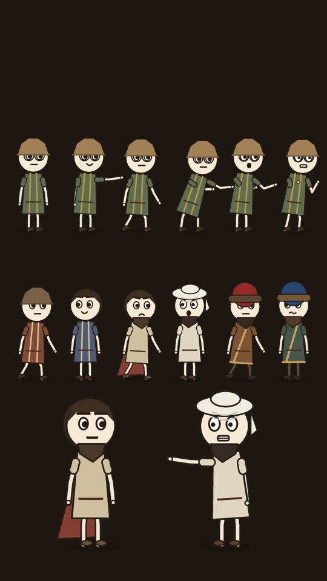

# Before Machines engine

Code rendered motion graphics for the Before Machines YouTube Shorts channel (ancient weapons, crafts and lost techniques). Every frame is drawn with Python and Pillow at 2x, then encoded with FFmpeg to a 1080x1920, 30 fps H.264 MP4 with AAC audio mastered to about -14 LUFS.



## Layout

| File | What it does |
|---|---|
| `detail.py` | Material helpers for detailed props: `lod()` by on screen size, `wood_plank` (grain, bevel, nails), `rivet`, `rope` (twist), `scratches`, light and shade tones |
| `fx.py` | Action effects: `smear`, `speed_lines`, `focus_lines`, `impact` frames, `particles` (dust, splash, spray, chips, sparks, debris), punchy preset `FX_GAIN` |
| `lib.py` | Easing, camera (punch, shake, drift factor), the camera aware 2x vector `Pen`, radial mask |
| `rig.py` | Skeleton rig (forward kinematics plus two bone IK hands), poses, 23 expressions, 11 facial hair styles, wardrobe, contact shadow |
| `props.py` | Sticker tags, stamp, callouts, arrows, trebuchet, castle, wall blocks |
| `env.py` | Painted environments, cached, blurred and graded so figures read clearly |
| `make_map.py` | Real coastline maps from `global-land-mask` (set `LEVELS` per episode) |
| `timeline.py` | Pause tightening, chapter pauses (padded with silence), word onsets to `timing.json` |
| `episodes/E017_sarissa/` | Latest episode: `sp.py` (phalangite rig with sarissa and pelta, hoplite rig with dory and aspis, Greek plain environment), `render_sp.py`, `audio_sp.py`, `timeline_sp.py`, `sheet_sp.py`. Engine additions: `rig.figure(mid=, b_behind=, b_hide=)` for shields worn on the back arm, Phrygian and pilos helmets, linothorax with pteruges, greaves; `props.sarissa`, `dory`, `pelta`, `aspis` (period library BM-P001 to BM-P006) |
| `episodes/E016_longbow/` | Previous episode: `lb.py` (longbow with sapwood and heartwood, arrows with IK archer hands, log end grain, butts, skeleton, French banner, furrows, rain, mud, green, workshop, lab and Agincourt environments, map levels), `render_lb.py`, `audio_lb.py` (adds twang, whiz, thunk, rain, volley and clatter), `timeline_lb.py` |
| `episodes/E015_corvus/` | Older episode: `cv.py` (galley with ram, corvus, pestle, field, beach and sea environments, map levels), `render_cv.py`, `audio_cv.py`, `timeline_cv.py` (word onsets from real timestamps), `asr_words.py` |
| `episodes/E014_greek_fire/` | Older episode: `gf.py` (props and environments), `render_gf.py` (beat table, scenes, captions, cue sheet), `audio_gf.py` (SFX, modal music bed, ducking, mix) |

Only the beat table `T`, `SCENES`, the `sc_*` scene functions, `EPISODE_OUTFIT` and map settings are episode specific. Everything else is the engine.

## Running an episode

The scripts import the engine modules from the same folder, so work in a scratch build folder:

```bash
pip install --break-system-packages pillow numpy scipy soundfile global-land-mask
mkdir build && cp *.py episodes/E014_greek_fire/*.py build/ && cd build
ffmpeg -i narration.mp3 -ar 48000 -ac 1 vo_orig.wav
pip install --break-system-packages pocketsphinx   # offline word timestamps, model bundled
ffmpeg -i vo_orig.wav -ar 16000 -ac 1 -f s16le vo16.raw && python3 asr_words.py > asr.txt
python3 timeline_cv.py           # edit PHR, SIL and DRAMA first; word onsets come from asr.txt
python3 make_map.py
python3 render_gf.py cues && python3 audio_gf.py
python3 render_gf.py still 0.5 3.0 7.0   # always look at stills first
python3 render_gf.py seg 0 771 | ffmpeg -f rawvideo -pix_fmt rgb24 -s 1080x1920 -r 30 -i - -c:v libx264 -preset veryfast -crf 17 -pix_fmt yuv420p a.mp4
```

Render in two parallel halves, check each frame count, join, then master: pre limit the mix (`volume=+5.8dB,alimiter=limit=0.70:level=false`), measure with `ebur128`, apply the remaining gain and limit again before AAC.

## Standards

**Audience.** Mostly US men aged 55 and over. One text element at a time, room to read, fewer but meaningful moves.

**Rig.** The E012 structure (see `docs/reference/e012_rig_sheet.png`): front-on body, big round head (about a third of body height) with round expressive eyes, a long torso, shoulders at the torso edges so the arms hang fully visible at the sides, hips set apart, bone limbs (cream fill, dark outline), short sleeve caps, small hands and shoes. A figure holding something draws its arms and hands in front of the clothing and on top of the prop, so the grip always shows (automatic when `held`, `hands` or `grip` is passed). In engine units: head r 46, torso 100, upper arm 38.5, forearm 37, thigh 37, shin 35.5, shoulders plus or minus 28, hips plus or minus 10. Garments stop at the knee so thighs and knees always show.

**Held objects (animator standard, applies to every prop).** Hand on the real grip point by IK, object driven by the hand, layered the way it is really held, clear of the body, weight shown in the pose, checked on a pose sheet first. Full rules in `docs/HELD_OBJECTS.md`.

**Prop detail (applies to every object).** As detailed as possible while the figures stay simple: real construction, material treatment, light and shadow, true curves, light wear, period accuracy, and level of detail by screen size so it reads on a phone. Full rules in `docs/PROP_DETAIL.md`.

**Action effects (every action).** Smears and speed lines on fast moves, impact frames on hits, particles by material, all tied to beat table times, punchy strength. Full rules in `docs/ACTION_FX.md`.

**Expressions and facial hair.** 23 expressions (eye shapes, mouths, extras like sweat and tears) and 11 facial hair styles, size aware so small figures stay readable, mouth always on skin. Full rules in `docs/EXPRESSIONS.md`.

**Edit.**
* Hard cuts by default, a slide push (about 0.35 s, always from the right) at 3 or 4 chapter turns, a 0.3 s dissolve on big brightness jumps, and match dissolves when the same object appears on both sides of a change. No radial wipes.
* About 6 camera punches per video, shakes only on impacts, at most one flash at half strength, camera drift at half strength.
* Captions word by word, 76 px, at most 4 words per chunk, keyword in amber, centered at y 1440.
* Tags only when they add something the caption does not: a date, a name's spelling, a hedge such as LIKELY.
* J cuts: the next shot's sounds start 0.12 s before the change.
* Never leave a frame empty after a change, and nothing floats.

**Word timing.** pocketsphinx (pip, bundled model) gives real word start times offline; E015 maps them onto the script with difflib and interpolates the few misheard words. Better than syllable splitting.

**History.** Only well documented facts. Hedge reconstructions and disputed points on screen (LIKELY, LATER ACCOUNTS, ROUTE SIMPLIFIED). Every costume and prop must match the period.
